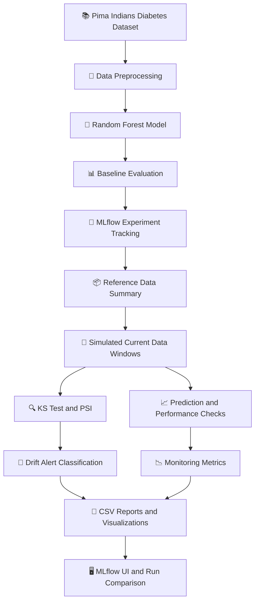

# 🩺 MediPredict – MLflow Experiment Tracking & Data Drift Analysis

<p align="center">
  <b>🚀 Machine Learning DevOps | Experiment Tracking | Model Monitoring</b>
</p>

<p align="center">
  
  
  
  
  
</p>

## 🌟 Project Overview

**MediPredict** is a Machine Learning DevOps (ML DevOps) project developed for **ISE-2 – UAMPC0703**. It demonstrates how a healthcare machine learning model can be trained, tracked, evaluated, and monitored for data drift using **MLflow** and statistical analysis techniques.

The project focuses on a diabetes-risk screening use case for a small clinic. A Random Forest classifier is trained on the Pima Indians Diabetes Database, and multiple simulated data scenarios are used to evaluate changes in patient feature distributions and model predictions.

💡 **Core idea:** A machine learning model that performs well during training may behave differently when incoming data changes. MediPredict demonstrates how to detect such changes and generate monitoring evidence.

> ⚠️ This is an educational project using simulated drift scenarios. It is not a clinically validated diagnostic system.

## 🎯 Project Objectives

- 🧠 Build a machine learning classification pipeline for diabetes-risk prediction.
- 📊 Track experiments, parameters, metrics, models, and artifacts using MLflow.
- 🔍 Detect data drift using the Kolmogorov–Smirnov (KS) test and Population Stability Index (PSI).
- 🚨 Generate feature-level and dataset-level drift alerts.
- 📈 Analyze prediction drift and supporting model-performance metrics.
- 🗂️ Store reproducible experiment results and visualizations.
- ⚙️ Demonstrate an introductory ML monitoring workflow inspired by production MLOps systems.

## 🏥 Use Case

| Component | Description |
|---|---|
| 🏥 Domain | Healthcare – diabetes-risk screening |
| 📚 Dataset | Pima Indians Diabetes Database |
| 🔢 Dataset size | 768 records |
| 🧬 Input features | 8 numerical health-related features |
| 🎯 Target | `Outcome` |
| 🤖 Algorithm | Random Forest Classifier |
| 🧹 Preprocessing | Median imputation using a scikit-learn pipeline |
| 🧪 Experiment tracking | MLflow |
| 📉 Drift detection | KS test and PSI |
| 📊 Visualization | Matplotlib |
| 🧮 Statistical analysis | SciPy and NumPy |

## ✨ Key Features

### 🧠 1. Machine Learning Model Training
- Trains a Random Forest classification model.
- Uses median imputation to handle missing or invalid measurements.
- Evaluates model performance using AUC, accuracy, recall, and F1-score.
- Creates a baseline for subsequent monitoring experiments.

### 🧪 2. MLflow Experiment Tracking
- Organizes experiments under `MediPredict-Diabetes-Drift`.
- Records model parameters and evaluation metrics.
- Logs the trained model and reference-data summary.
- Saves drift tables, CSV files, and plots as artifacts.
- Supports run comparison through the MLflow user interface.

### 🔍 3. Statistical Data Drift Detection
Uses two complementary methods to assess changes in feature distributions:

- **Kolmogorov–Smirnov (KS) test:** Evaluates whether two samples may come from different distributions.
- **Population Stability Index (PSI):** Quantifies the magnitude of distribution changes relative to the reference population.

A feature is flagged when the corrected KS test is statistically significant and PSI is at least 0.1.

### 📈 4. Prediction Drift Monitoring
- Compares reference and current prediction probabilities.
- Uses a KS test to identify changes in predicted-risk distributions.
- Records the mean predicted risk for each scenario.

### 📊 5. Model Performance Monitoring
Evaluates the model on labeled scenario records using:

- ROC-AUC
- Accuracy
- Recall
- F1-score

These metrics provide supporting evidence about model behavior under simulated changes.

### 🚨 6. Automated Drift Alerts
Assigns an alert level based on the number of flagged features:

| Alert | Condition | Interpretation |
|---|---|---|
| 🟢 `NONE` | 0 flagged features | No features meet the configured drift criteria |
| 🟡 `FEATURE_ALERT` | 1 or more flagged features | At least one feature meets the drift criteria |
| 🔴 `DATASET_DRIFT` | At least 2 of 8 features flagged | Dataset-level drift alert |

**Note:** `DATASET_DRIFT` takes precedence when at least two features are flagged. These alert thresholds are project design choices, not clinical standards.

## 🏗️ System Architecture



## 🔬 Drift Detection Methodology

### 📌 Reference and Current Data

- **Reference data:** A stratified 50% training split used as the baseline for drift comparison.
- **Current data:** 150 records sampled from the other 50% of the dataset.
- **Simulated monitoring:** Four current-data scenarios represent different types of distribution changes.

Since the dataset does not contain a genuine time axis, these scenarios simulate possible changes rather than demonstrating real-world temporal drift.

### 📐 Statistical Thresholds

| Method | Threshold | Meaning |
|---|---|---|
| KS test | Corrected p-value < 0.00625 | Statistically significant distribution difference |
| PSI | < 0.1 | Stable according to the configured PSI rule |
| PSI | 0.1 to < 0.2 | Moderate shift |
| PSI | ≥ 0.2 | Significant shift |

The KS threshold uses a Bonferroni correction for eight features: 0.05 / 8 = 0.00625.

### 🧹 Handling Missing Values

In the dataset, zero values for the following measurements are treated as missing:

- Glucose
- BloodPressure
- SkinThickness
- Insulin
- BMI

The pipeline uses median imputation to handle missing values during model preprocessing.

## 🧪 Experiment Scenarios

The project records the following MLflow runs:

| Experiment run | Purpose |
|---|---|
| `baseline_training` | Trains and evaluates the reference model |
| `control_no_shift` | Tests an unseen sample expected to have no deliberate shift |
| `population_shift_moderate` | Simulates a moderate change in patient population |
| `population_shift_severe` | Simulates a stronger population change |
| `glucose_unit_change` | Simulates a data-quality issue caused by glucose values recorded in mmol/L instead of mg/dL |
| `summary_all_scenarios` | Collects scenario summaries in `drift_summary.csv` |

### 📊 Expected Observations

- The control scenario should provide a comparison with the reference distribution.
- Moderate and severe population-shift scenarios explore how drift indicators respond to different selection biases.
- The glucose-unit-change scenario demonstrates how inconsistent measurement units can affect feature distributions.
- Prediction drift and model-performance changes may accompany data drift, but they are not guaranteed.

Actual outcomes must be verified from the generated metrics and artifacts rather than assumed in advance.

## 🛠️ Technology Stack

| Technology | Purpose |
|---|---|
| 🐍 Python | Main programming language |
| 🧠 Scikit-learn | Machine learning and preprocessing |
| 🧪 MLflow | Experiment tracking and artifact logging |
| 📐 SciPy | Statistical KS tests |
| 🔢 NumPy | Numerical calculations and PSI |
| 📊 Pandas | Dataset manipulation and reporting |
| 📈 Matplotlib | Distribution plots and drift visualizations |
| 🗃️ SQLite | Local MLflow backend store |

## 📂 Project Structure

```text
MediPredict/
│
├── drift_pipeline.py          # Training, drift detection and MLflow logging
├── requirements.txt           # Project dependencies
├── README.md                  # Project documentation
├── requirements-lock.txt      # Exact installed package versions
│
├── data/
│   └── diabetes.csv           # Dataset, if stored locally
│
├── results/
│   ├── drift_summary.csv      # Scenario summary
│   ├── psi_*.png              # PSI visualizations
│   └── distributions_*.png    # Feature distribution plots
│
└── screenshots/
    ├── environment.png        # Python and MLflow versions
    ├── mlflow_experiments.png # Experiment and run list
    ├── compare_runs.png       # Run comparison
    └── drift_analysis.png     # Scenario metrics and artifacts
```

*The generated files and screenshot names may vary depending on the implementation.*

## ⚙️ Installation and Setup

### 1️⃣ Clone the Repository

Replace `YOUR-USERNAME` with your GitHub username.

```bash
git clone https://github.com/YOUR-USERNAME/MediPredict.git
cd MediPredict
```

If your GitHub repository has a different name, use that name in the URL and directory.

### 2️⃣ Check Python

```bash
python --version
```

Python 3.10 or later is a suggested starting point, subject to compatibility with the pinned dependencies.

### 3️⃣ Create a Virtual Environment

**Windows:**

```bash
python -m venv .venv
.venv\Scripts\activate
```

**Linux or macOS:**

```bash
python -m venv .venv
source .venv/bin/activate
```

### 4️⃣ Install Dependencies

```bash
python -m pip install --upgrade pip
pip install -r requirements.txt
```

### 5️⃣ Run the Pipeline

```bash
python drift_pipeline.py
```

The pipeline downloads `data/diabetes.csv` if it is missing and the automatic download succeeds.

If the download fails, obtain the dataset from a legitimate source and save it to `data/diabetes.csv`. Alternatively, supply a local dataset path if supported by the script:

```bash
python drift_pipeline.py --data data/diabetes.csv
```

### 6️⃣ Launch the MLflow UI

```bash
mlflow ui --backend-store-uri sqlite:///mlflow.db --port 5000
```

Open the following address in your browser:

👉 [http://127.0.0.1:5000](http://127.0.0.1:5000)

You can inspect experiment runs, compare metrics, and explore logged artifacts.

> 💡 Run the pipeline before opening the UI to populate the experiment results.

## 📸 Screenshots for Project Documentation

Capture these screenshots and save them in the `screenshots/` folder:

1. 💻 Terminal displaying Python and MLflow versions.
2. 🧪 MLflow experiment list containing the scenario runs.
3. 📊 Run comparison showing scenario metrics.
4. 🔍 A scenario run page showing parameters, metrics, and artifacts.
5. 📈 PSI plots for severe population shift and glucose-unit change.
6. 📉 Feature distribution plots comparing reference and current data.

These screenshots can support the ISE-2 practical report and project demonstration.

## 🔁 Reproducibility and Version Tracking

Record the software environment used for the experiment:

```bash
python --version
mlflow --version
pip freeze > requirements-lock.txt
```

For stronger reproducibility, record the dataset source, random seeds, package versions, experiment parameters, and any changes to the drift thresholds.

## ☁️ Optional: AWS-Based MLflow Tracking

The project can optionally be connected to an AWS-hosted MLflow setup, if the remote server is configured and accessible.

The proposed architecture includes:

- ☁️ Amazon EC2 for hosting the MLflow server.
- 🔐 AWS Systems Manager Session Manager for secure port forwarding.
- 🗄️ Amazon RDS PostgreSQL for experiment metadata.
- 📦 Amazon S3 for artifact storage.

The local version of this ISE-2 project uses SQLite and local artifact
